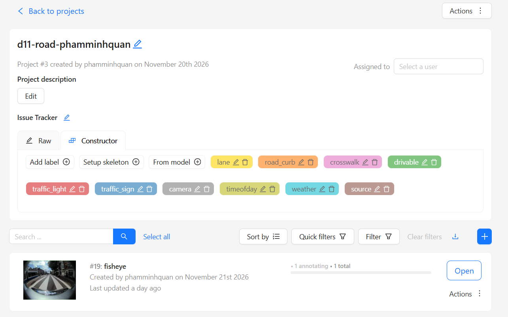
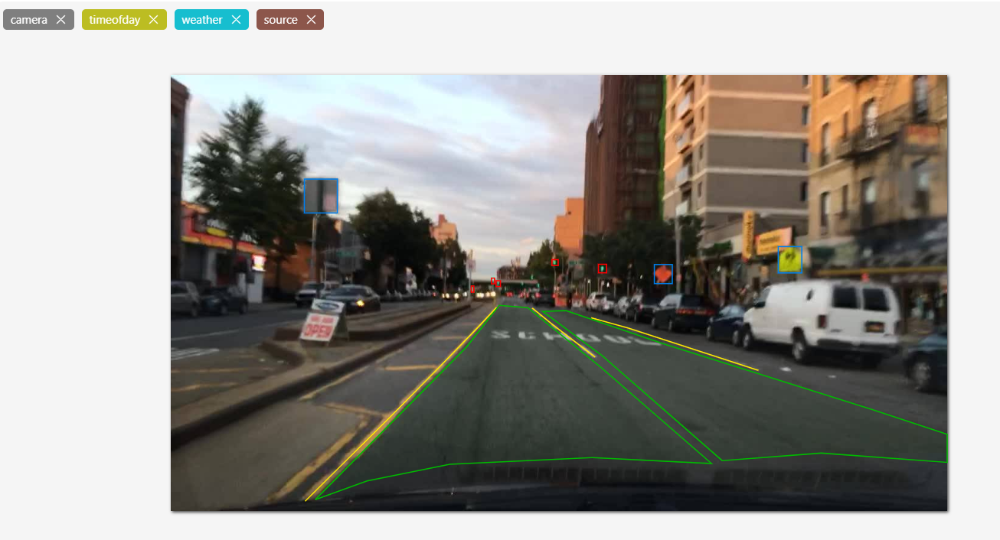
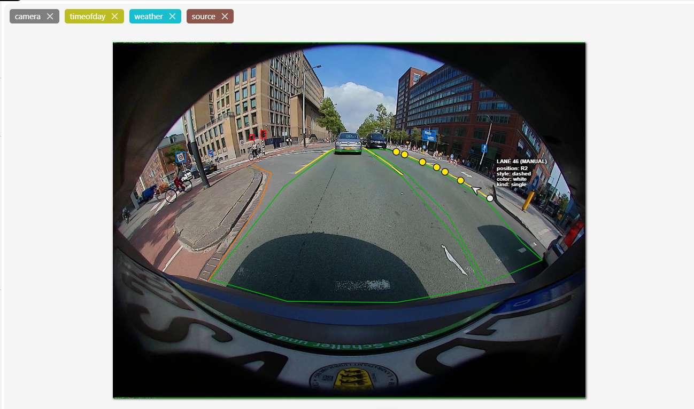
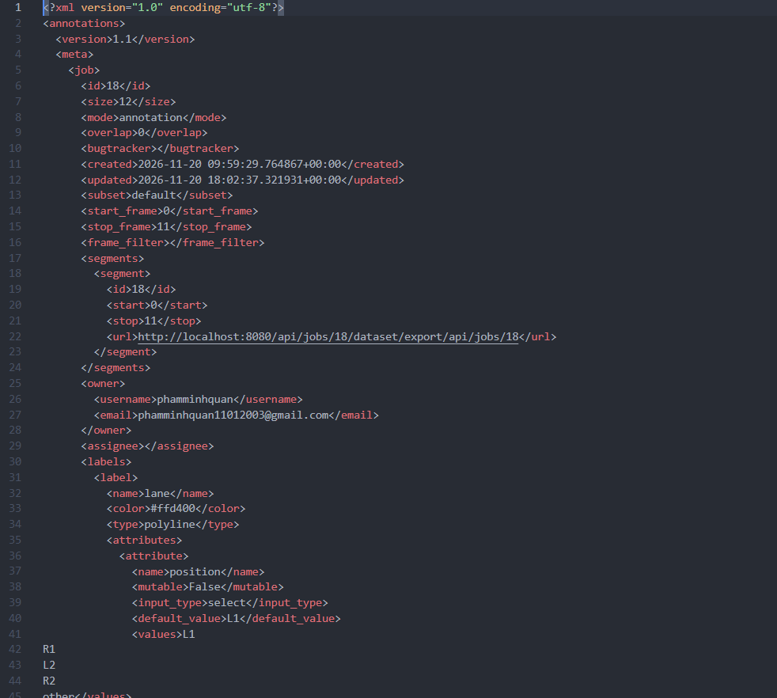

# Báo cáo cá nhân — Ngày 11

Họ tên: Phạm Minh Quân Mã học viên: 2A202603307
Phiên bản CVAT (Help → About): 2.74.1
Guideline: Road v1.0 Lần nộp (`revision` trong manifest): 1
Thời điểm export (ngày giờ trên CVAT): 2:57 Số lần nộp lại sau Rework: 1

## 1. Kiểm project

| Mục                                       | Đúng như guideline Road v1.0? | Ghi chú |
| ----------------------------------------- | ----------------------------- | ------- |
| 6 label, đúng kiểu                        | Đúng                          |         |
| Thuộc tính và giá trị                     | Đúng                          |         |
| 4 tag ảnh                                 | Đúng                          |         |
| Cách kết thúc polyline trên bản CVAT này: | Đúng                          |         |
| Cách đặt tag ảnh trên bản CVAT này:       | Đúng                          |         |

## 2. Số lượng đã gán

| Task                         | Ảnh | lane | road_curb | crosswalk | drivable | traffic_light | traffic_sign |
| ---------------------------- | --: | ---: | --------: | --------: | -------: | ------------: | -----------: |
| front                        |  12 |   30 |         9 |         4 |       27 |            35 |           29 |
| front-extra (đã làm 0 / 4)   |   0 |    0 |         0 |         0 |        0 |             0 |            0 |
| fisheye                      |   8 |   10 |         9 |         8 |        9 |             6 |            5 |
| fisheye-extra (đã làm 0 / 4) |   0 |    0 |         0 |         0 |        0 |             0 |            0 |

## 3. Bảng ca khó

| Ảnh | Nhãn | Phân vân giữa | Đã chọn | Lý do |
| --- | ---- | ------------- | ------- | ----- |

## 4. Phiếu QC 1 nhận được

Bạn kiểm lô của tôi: **Dương Mạnh Huy (duongmanhhuy)**. Quyết định nhận được: **Rework** (phiếu ngày 21/11/2026, revision 1).

| Mã lỗi                                                            | Số lỗi | Đồng ý? | Đã sửa? |
| ----------------------------------------------------------------- | -----: | ------- | ------- |
| QC1-02 — thiếu L1 tại A07 và A09                                  |      2 | Đồng ý  | Đã sửa  |
| QC1-04 — polyline L2 tại A01 lệch tâm vạch                        |      1 | Đồng ý  | Đã sửa  |
| QC1-07 — vùng lái thiếu hoặc sai phạm vi tại A01, A03, A07 và A09 |      6 | Đồng ý  | Đã sửa  |
| QC1-08 — thiếu đèn tại A03, A09 và B02                            |      5 | Đồng ý  | Đã sửa  |

## 5. Kiểm file export

| File                     | Mở lại được?                           | Số shape ảnh 1 (job / file) | Số shape ảnh 2 (job / file) | Tag camera có trong XML?                             |
| ------------------------ | -------------------------------------- | --------------------------- | --------------------------- | ---------------------------------------------------- |
| phamminhquan-front.zip   | Có, đọc được annotations.xml trong ZIP | A01: 10 / 10                | A02: 9 / 9                  | Có, đủ 12/12 ảnh; A01 và A02 có camera = front       |
| phamminhquan-fisheye.zip | Có, đọc được annotations.xml trong ZIP | B01: 4 / 4                  | B02: 8 / 8                  | Có, đủ 8/8 ảnh; B01 và B02 có camera = fisheye_front |

## 6. Ảnh chụp màn hình

1. Tab Labels của project. 
2. Một ảnh camera trước đã gán đủ (làn, vùng lái, đèn/biển). 
3. Một ảnh fisheye đã gán, phóng to đoạn polyline cong. 
4. Một đoạn XML có

   

## 7. Tự đánh giá

Lỗi bạn mắc nhiều nhất hôm nay (theo mã QC1-xx), và cách tránh ở Ngày 20:

Theo phiếu QC , trong 6 ảnh được kiểm, tôi mắc nhiều nhất lỗi QC1-07 về vùng lái (6 lỗi): bỏ sót vùng direct/alternative ở A01, A03, A07, A09 và vẽ vùng direct ở A07 dừng theo đuôi xe phía trước. Ở Ngày 20, tôi sẽ xác định làn đang đi và các làn cùng chiều bên cạnh trước khi vẽ, kiểm riêng area_type của từng polygon và áp dụng đúng quy tắc “đi được nếu đường trống”, không khoét vùng lái quanh xe khác. Trước khi chuyển ảnh, tôi sẽ đối chiếu từng nhóm nhãn theo kế hoạch ảnh. Tôi cũng cần rà kỹ vạch L1/R1 và phóng to các cụm đèn nhỏ, đèn quay lưng để tránh bỏ sót như trong phiếu QC.

Nhãn của bạn đi vào model ở đâu? Chọn một lỗi đã sửa và nói nó làm model học sai thế nào:

Nhãn tôi gán là dữ liệu đích để huấn luyện mô hình: polyline cung cấp vị trí vạch làn, polygon cung cấp vùng và loại vùng lái, còn box cùng thuộc tính cung cấp vị trí và thông tin đèn/biển. Ví dụ, lỗi QC1-07 ở A07 là vẽ vùng direct dừng ở đuôi xe phía trước. Nếu polygon này được chuyển thành mặt nạ huấn luyện phân đoạn vùng lái, phần làn đường phía trước bị loại khỏi vùng direct sẽ tạo dữ liệu đích sai, khiến mô hình có thể học rằng vùng lái kết thúc ở xe phía trước thay vì phản ánh phần đường đi được nếu đường trống. Tôi đã sửa polygon theo guideline; nhãn đúng giúp mô hình học vùng lái nhất quán hơn. Nhãn vùng lái này không thay thế việc phát hiện xe và vật cản để quyết định đường đi an toàn.

## 8. (Tùy chọn, buffer) Từ polyline đến đích row-anchor

| y               | 720 | 680 | 640 | 600 | 560 |
| --------------- | --: | --: | --: | --: | --: |
| x của chúng tôi |     |     |     |     |     |
| x của bạn kia   |     |     |     |     |     |

Trả lời 3 câu:

1. Năm số x đó chính là đích mà một model row-anchor học cho vạch này. Nếu bạn dừng polyline sớm 40 px, hàng nào đổi thành "không có làn"?
2. So với bạn được kiểm (cùng ảnh): ở hàng 720 và hàng 560, hai bạn lệch nhau bao nhiêu pixel? Lệch ở hàng nào ảnh hưởng LKA nhiều hơn (slide 25)?
3. Nếu polyline vẽ từ xa về gần (ngược quy tắc 2), cách tính trên có đổi không? Script nào sẽ gặp khó?
